# Team Ticket Hub

A team task application with manager assignment, employee checklists, persistent login,
and a Docker operations environment you can inspect and explain.

The product uses **React 19, Vite 8, Express 5 and SQLite**. Its production image serves
the compiled frontend and JSON API in **one application container**. Six supporting
containers provide metrics, dashboards, availability checks, logs and Docker management.


**Preparing for an interview?** Start with the [learning path](docs/README.md), open
the [visual presentation](docs/presentation.html), then practice the
[interview walkthrough](docs/interview-guide.md). Download/clone the repository to open
the HTML presentation locally; GitHub displays the individual SVG diagrams directly.

## What the application does

| User | Capabilities |
| --- | --- |
| Manager | View all tasks and team members; create, edit, delete, assign and reassign tasks |
| Employee | Manage personal tasks; view assigned tasks; update assigned checklist completion |
| Every signed-in user | View a dashboard and personal workspace; edit name, email and date of birth |

An assigned employee cannot change someone else's task definition or delete it.
These restrictions are enforced by the API as well as the interface. Registration
creates an employee account and checks that the supplied birth date indicates age 18+;
it does not verify identity. There is no public manager-signup option.

Task status is calculated from checklist steps: **Open → In progress → Completed**.
Unchecking a step can reopen work. The database does not store a separate status field.

## Open the running local stack

The configured Mac checkout is `/Users/vaghiksargsyan/Desktop/Projects/team-ticket-hub`.
Docker runs in a Colima Linux VM. All seven interfaces bind to localhost.

| Service | Browser URL | What to show |
| --- | --- | --- |
| Application | <http://127.0.0.1:3001> | Manager/employee workflows |
| Grafana | <http://127.0.0.1:3000/d/ticket-poc> | Provisioned container dashboard |
| Portainer | <https://127.0.0.1:9443> | Containers, networks and volumes |
| Uptime Kuma | <http://127.0.0.1:3002> | Readiness and homepage availability |
| Dozzle | <http://127.0.0.1:8081> | Structured application logs |
| Prometheus | <http://127.0.0.1:9090/targets> | Scrape targets and PromQL |
| cAdvisor | <http://127.0.0.1:8082> | Exported container resource information |

Monitoring usernames and passwords are in the ignored `secrets/local-access.txt`.
Portainer uses a self-signed local certificate. Prometheus/cAdvisor host ports are
provided by `compose.ops.local.yml`; the baseline operations file keeps them internal.

Resume this **already configured** stack from the repository root:

```sh
colima start
docker compose --env-file .env -f compose.app.yml up -d --wait
docker compose --env-file .env -f compose.ops.yml -f compose.ops.local.yml up -d --wait
```

See [local Docker setup](docs/local-docker.md) for first-time setup, rebuilds, volumes
and stopping safely. The local Docker database and `data/dashboard.sqlite` are separate
copies; subsequent writes are not synchronized.

## Run the application from source

Use Node **22.23.3**, pinned in `.nvmrc`. Python 3 runs the host-operations tests.

```sh
nvm install
nvm use
npm ci
npm test
npm run dev
```

Open <http://127.0.0.1:5173>. Development runs Vite on 5173 and Express on 3001;
Vite proxies `/api` to Express. Stop the Docker app first if it already owns port 3001.
If its tools remain running, Kuma will report the Docker app unavailable during that period.

For a local production build:

```sh
npm run build
npm start
```

Open <http://127.0.0.1:3001>. Express serves `dist/` and the API. The default database
is `data/dashboard.sqlite`. Register an account, or explicitly seed the fictional demo:

```sh
npm run seed:demo
```

| Role | Demo email | Local demo password |
| --- | --- | --- |
| Manager | `manager@example.test` | `Admin@123` |
| Employee | `alex@example.test` | `Admin@123` |
| Employee | `sara@example.test` | `Admin@123` |
| Employee | `demo@example.test` | `Admin@123` |

The seed writes eight sample tasks and `.env.demo`; repeated runs preserve sample task
progress, reset those four accounts' passwords/roles and leave other accounts alone.
It refuses production mode. Running it on the host does **not** seed the Docker volume.
The configured Docker demonstration already contains its migrated demo accounts.

## Understand the architecture



| Area | Responsibility | Read next |
| --- | --- | --- |
| `src/features/`, `src/components/` | React views and reusable controls | [Application architecture](docs/architecture.md) |
| `src/app/useWorkspace.js`, `src/lib/http.js` | UI state, operations, JSON transport and errors | [A request walkthrough](docs/architecture.md#follow-one-checklist-update) |
| `backend/`, `server.js` | Middleware, sessions, validation, permissions and SQLite | [API and data model](docs/architecture.md#api-reference) |
| `Dockerfile`, `compose.*.yml` | Runtime image, networks, ports and storage | [Infrastructure explained](docs/infrastructure.md) |
| `.github/workflows/ci.yml`, `scripts/` | Verification, release, deployment and recovery | [Delivery and recovery](docs/delivery-and-recovery.md) |
| `monitoring/` | Prometheus scrape configuration and Grafana provisioning | [Monitoring signals](docs/infrastructure.md#what-each-monitoring-tool-proves) |

## What is verified, and what is designed

On **23 October 2026**, the local stack was checked with **20 passing Node tests** on
Node 22.23.3, **15 passing Python tests**, a real disposable Docker persistence/restore
exercise, two healthy Prometheus targets and a working six-panel Grafana dashboard.
The application runs as UID 1000 and its readiness endpoint returns `local-workspace`.

The repository also includes a Linux VPS delivery design: GitHub Actions verifies and
scans images, GHCR publishes releases, a host timer resolves `poc` to an immutable digest,
and the operator verifies or recovers the rollout. These local checks do not establish
live GHCR publication, a deployed VPS, public TLS, functioning Linux timers, external
alert delivery or off-host recovery. Read the [dated evidence and limitations](docs/verification.md).

For that deployment path, use the [public deployment guide](docs/public-deployment.md)
and [Linux runbook](docs/runbook.md). `deployment.env.example` is a planning worksheet;
its copied `deployment.env` is not automatically read by the app or CI.

## Verify the project

```sh
npm test
npm run build
node scripts/smoke-test.mjs http://127.0.0.1:3001
# Uses disposable containers and volumes, preserving the demo database:
EXPECTED_REVISION=local-workspace bash scripts/container-smoke.sh ticket-dashboard:local
```

For a real commit-labelled image, use its actual revision instead of `local-workspace`.
The container test needs Node on the host, Docker and a previously built image.
The Trivy gate is a separate check: `bash scripts/scan-image.sh ticket-dashboard:local`.
It can fail for current vulnerability findings; a successful build alone does not imply a clean scan.

## Documentation map

| Goal | Document |
| --- | --- |
| Learn from the beginning | [Learning path](docs/README.md) · [Glossary](docs/glossary.md) |
| Present and rehearse | [Offline diagram presentation](docs/presentation.html) · [Interview guide](docs/interview-guide.md) |
| Read code and explain permissions | [Application architecture](docs/architecture.md) |
| Explain Docker and observability | [Infrastructure](docs/infrastructure.md) |
| Explain CI/CD, rollback and backups | [Delivery and recovery](docs/delivery-and-recovery.md) |
| Operate the configured Mac setup | [Local Docker guide](docs/local-docker.md) |
| Deploy and operate Linux | [Public deployment](docs/public-deployment.md) · [Operations runbook](docs/runbook.md) |
| Assess evidence and tradeoffs | [Verification](docs/verification.md) · [Design decisions](docs/decisions.md) |
| Edit or export diagrams | [Diagram atlas](docs/diagrams/README.md) · [Diagram tooling and plugin choice](docs/diagram-tooling.md) |

This is a single-instance learning project: no high availability, multi-tenant isolation,
central log archive, distributed tracing or automatic off-host backups are included.
Local demo credentials are for this demonstration; public deployment requires its own credentials.
