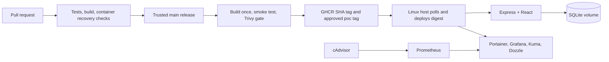

# Ticket Dashboard

React 19, Vite 8, Express 5 and SQLite, with a local Linux DevOps proof of concept.
Users can register, sign in, manage their own tickets and checklists, and edit their profile.

For a public VPS with automatic HTTPS, one-minute deployment polling and daily backups,
start with [the public deployment guide](docs/public-deployment.md). Monitoring is optional
on that path; the full local operations stack is described below.
If the hosting account will be created later, copy `deployment.env.example` to
`deployment.env` and fill in its account/server placeholders when ready.

The DevOps setup includes a non-root Docker image, GitHub Actions checks, scanned GHCR
releases, digest-based deployment with rollback, SQLite snapshots, Portainer, Prometheus,
cAdvisor, Grafana, Uptime Kuma and Dozzle.

## Run the app

Use Node **22.23.3** (`.nvmrc`) and Python 3 for the operations tests. Node 22.16 or later
supports the SQLite backup helper. With nvm installed:

```sh
nvm install
nvm use
npm ci
npm test
npm run dev
```

Open <http://127.0.0.1:5173>. Create your own account; there is no default login.
Registration requires a date of birth showing an age of at least 18. This is a date
validation, without identity verification.

To serve the production frontend locally:

```sh
npm run build
npm start
```

Open <http://127.0.0.1:3001>. The database defaults to `data/dashboard.sqlite`.
`HOST`, `PORT`, `DATABASE_PATH`, `COOKIE_SECURE` and `APP_REVISION` can be exported
before startup. HTTP development uses `COOKIE_SECURE=false`.

## Try the app in Docker

For this Mac's complete local stack, browser URLs and restart commands, see
[the local Docker guide](docs/local-docker.md).

Use a Linux Docker host with a current Compose plugin. Commands below use an isolated
local data volume so the managed deployment has its own data.

```sh
cp .env.example .env
docker network create ticket-poc-net
docker build -t ticket-dashboard:local .
APP_VOLUME=ticket-poc-local-data docker compose --env-file .env -f compose.app.yml -p ticket-local up -d --wait
curl -fsS http://127.0.0.1:3001/api/health/ready
```

Stop this local project before starting the managed app on port 3001:

```sh
APP_VOLUME=ticket-poc-local-data docker compose --env-file .env -f compose.app.yml -p ticket-local down
```

The volume remains available for the next local run. Use one app instance and local
Docker storage for SQLite.

## Run the DevOps POC

Follow [the operations runbook](docs/runbook.md) for Linux setup, management credentials,
first deployment, timers, monitoring and recovery. Start manually and complete a restore
and rollback exercise before enabling the deployment timer.

| Interface | Docker-host address |
| --- | --- |
| Ticket Dashboard | <http://127.0.0.1:3001> |
| Portainer CE | <https://127.0.0.1:9443> |
| Grafana | <http://127.0.0.1:3000> |
| Uptime Kuma | <http://127.0.0.1:3002> |
| Dozzle | <http://127.0.0.1:8081> |
| Prometheus and cAdvisor | Docker network only |

For another computer, use the SSH forwarding commands in the runbook. Management tools
have their own logins. Portainer's initial certificate is self-signed.



The single workflow in `.github/workflows/ci.yml` verifies PRs and main, then permits
publication only for main. It publishes `sha-<full-source-SHA>` and promotes `poc` after
tests and scanning. The host resolves `poc` to an immutable registry digest. Configure
the `verify` required check in GitHub settings; adding a workflow does not enable branch
protection. Set GHCR package visibility separately if anonymous host pulls are desired.

## Verification and project files

```sh
npm test
npm run build
# Docker host only; this creates and removes disposable test volumes:
bash scripts/container-smoke.sh ticket-dashboard:local
```

The tests cover authentication, ownership, health, private logs, live WAL snapshots,
deployment failure, rollback and state recovery. The container check also verifies
frontend assets, non-root execution, graceful stop, account/session persistence and
restore into a separate volume.

See [implementation decisions](docs/implementation.md) for how the three PDF plans were
reconciled and [acceptance evidence](docs/POC_ACCEPTANCE.md) for verified results and
remaining host exercises. Docker runtime, GHCR publication and actual alert delivery
require the deployment environment; generated configuration alone does not establish
those results.

| Path | Purpose |
| --- | --- |
| `src/` | React features, shared components, API client and application controller |
| `backend/`, `server.js`, `server.test.js` | Backend modules, stable server entry point and regression tests |
| `Dockerfile`, `compose.app.yml` | Application image, persistent volume and local access |
| `compose.ops.yml`, `monitoring/` | Private operations tools and provisioned dashboard |
| `scripts/` | Deployment, smoke checks, snapshots, restore and tests |
| `systemd/` | Optional deployment and daily backup timers |
| `docs/runbook.md` | Setup, operation, recovery and troubleshooting |

## Manager and employee demo

The React interface uses the official `@clr/ui` Clarity HTML/CSS design system.
Main views are Dashboard, Tasks, Users (manager only) and My profile; each team
member also has a personal workspace at `#users/<id>`. Sign-in is a separate view.

Managers can view the team, create tasks, assign/reassign employees and edit task
details. Employees see their own/assigned tasks and update assigned checklist
progress. They cannot change an assigned task’s definition, delete it or assign it
to another employee. Employees may also keep personal tasks.

Run `npm run seed:demo` to write fictional demo accounts and eight realistic tasks
directly to local SQLite. Existing non-demo data is preserved. Repeated runs reuse
the sample tasks and reset only the four explicit demo accounts to their documented
simple passwords. The command refuses production mode.

All credentials are in `.env.demo` (owner-only permissions, ignored by Git and Docker):

| Role | Email | Password |
| --- | --- | --- |
| Manager | manager@example.test | manager123 |
| Employee | alex@example.test | alex12345 |
| Employee | sara@example.test | sara12345 |
| Employee | demo@example.test | demo12345 |

Existing databases receive an additive role/assignment migration. Existing users
remain employees; public registration and profile edits cannot promote roles.
See [code architecture](docs/architecture.md) for module boundaries and
[Clarity’s framework-independent installation guide](https://v15.clarity.design/get-started)
for the HTML/CSS integration approach. The installed package is version 18.4.0.
