# Learn and present Team Ticket Hub

Start here if you can run the project but cannot yet explain all its parts.
The goal is to follow real requests and demonstrate real behavior, then use precise
words for what you understand. Adjust the sample first-person scripts to your actual
contribution, including any assistance or tools used.

## The first mental picture

A manager creates work. An employee completes its checklist. React shows the screens;
Express decides what is allowed; SQLite remembers the result. Docker packages the
application, and six other containers help an operator observe and manage it.

The **application** solves the user's task problem. **Infrastructure** runs that
application. **Observability** helps explain its behavior. **Delivery and recovery**
help change it and recover from failures. Learn these as related responsibilities.

## A practical learning order

The times below are suggested study sessions, not measured proficiency claims.

| Session | Read and do | You should be able to explain |
| --- | --- | --- |
| 1 · 20–30 minutes | Read the root README; sign in as manager and employee | Who the users are, what a ticket contains, which actions differ by role |
| 2 · 30–45 minutes | Read [architecture](architecture.md); follow one checklist update through code | How React calls Express, how a session identifies a user, how permissions protect SQL |
| 3 · 30–45 minutes | Read [infrastructure](infrastructure.md); open Portainer, Grafana, Kuma and Dozzle | Image vs container vs volume, the two networks, three monitoring signals |
| 4 · 30–45 minutes | Read [delivery and recovery](delivery-and-recovery.md); inspect the workflow and smoke script | PR vs publication, tag vs digest, successful rollout vs recovery, backup vs restore |
| 5 · 30 minutes | Use the [interview guide](interview-guide.md) and [presentation](presentation.html) | A coherent two-minute story and a reproducible 15-minute demo |

When a term is unfamiliar, use the [glossary](glossary.md). When a claim is uncertain,
check [verification](verification.md) and open the linked source file.

## Learn by following one action

1. Sign in to the app as the manager using the demo account in the root README.
2. Find a demo task and note its assigned employee.
3. Open a separate browser profile/private window as that employee.
4. Toggle a checklist item and reload. The change persists in SQLite.
5. Open `src/app/useWorkspace.js` and find `toggle`.
6. Open `src/lib/http.js`: the request is a JSON `PATCH` under `/api` with a cookie.
7. Open `backend/app.js`: the cookie hash resolves the signed-in user.
8. Open `backend/routes/tickets.js`: the server allows checklist progress and rejects a changed task definition for an assigned employee.
9. Open `backend/repositories/tickets.js`: find the visibility filter and SQL update.
10. Open `backend/domain/serializers.js`: the response converts stored checklist JSON into an API object.

Explain the round trip out loud before introducing Docker or CI/CD.

## Understand these distinctions

| Often confused | In this project |
| --- | --- |
| Frontend and backend | Separate source responsibilities; one production app container |
| Database and database server | SQLite is an embedded file; there is no PostgreSQL/MySQL container |
| Authentication and authorization | A session identifies you; role/ownership/assignment limit your actions |
| Ticket owner and assignee | `user_id` is its creator; `assignee_id` is the employee doing assigned work |
| Docker image and volume | Image contains code; named volume holds changing data |
| Metrics, checks and logs | Resource trends, HTTP availability and event details answer different questions |
| CI and deployment | A workflow can pass without a VPS receiving and running the release |
| Rollback and restore | Switch image version vs recover database contents |
| Local demo and public server | Colima/localhost now; optional Linux/Caddy/systemd deployment separately |

## How to use the visuals

Open `docs/presentation.html` directly in a browser. It works offline: SVGs, navigation,
styles and speaker notes are included. Arrow keys change diagrams, +/− zoom, and
**Print / PDF** prints the complete atlas. Each diagram also has an editable Mermaid
source and a standalone SVG under [diagrams](diagrams/README.md).

For each picture, practice three sentences:

1. **Purpose:** what question this diagram answers.
2. **Mechanism:** follow one arrow or state transition using a concrete example.
3. **Tradeoff:** explain one limitation and what you would change when requirements grow.

The [plugin assessment](diagram-tooling.md) explains the suggested tldraw integration
and the repository's Mermaid workflow.

## Ready-to-present checklist

- Explain the product without naming a tool in the first sentence.
- Follow a successful login and explain where the token and its hash live.
- Show that manager/employee permissions exist on the server.
- Identify the persistent app volume in Portainer.
- Distinguish a healthy Prometheus target from an available HTTP application.
- Explain how the candidate image becomes `current` only after verification.
- Explain why an image rollback does not restore yesterday's tickets.
- State which checks ran locally and which public-server exercises remain pending.
- Name one real limitation and propose a proportionate next improvement.

Use [interview questions](interview-guide.md#questions-to-practice) to test understanding
rather than memorizing tool names.
